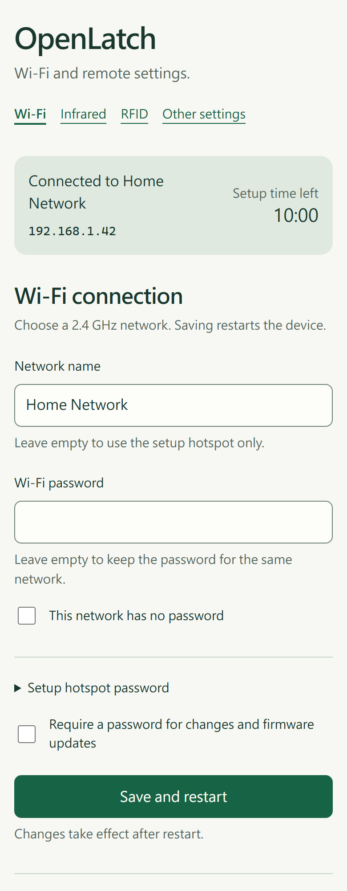
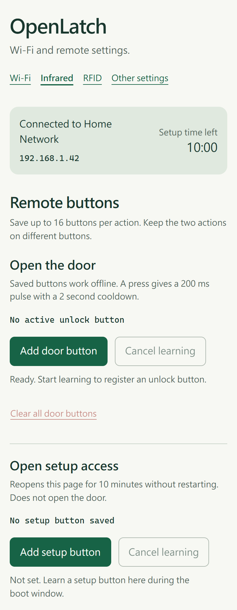
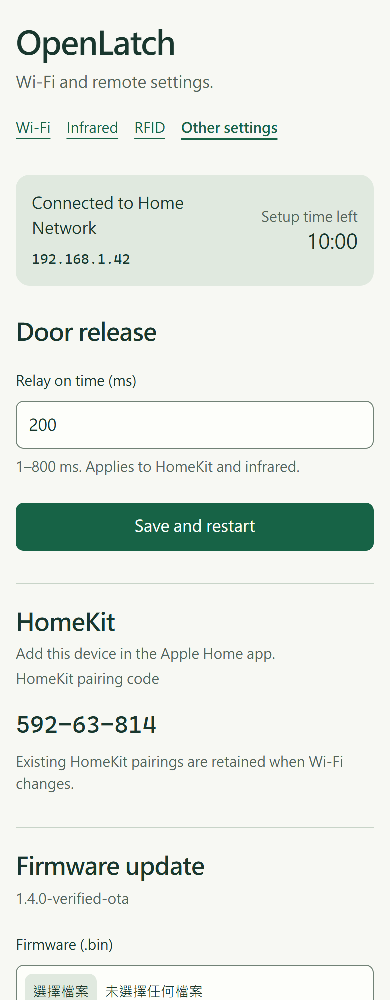
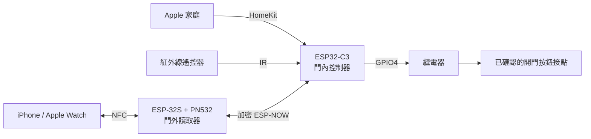

# OpenLatch

**用 Apple 家庭與紅外線遙控器，控制既有的開門按鈕。**

[門內控制器](projects/indoor-controller/README.md) · [門外讀取器](projects/outdoor-reader/README.md) · [接線與操作手冊](projects/indoor-controller/docs/openlatch_manual_zh-TW.md) · [驗證紀錄](projects/indoor-controller/VALIDATION.md)

OpenLatch 以 ESP32-C3 驅動繼電器，輸出短暫的開門脈衝。用手機瀏覽器即可設定 Wi-Fi、學習遙控器按鍵與更新韌體；Apple Home Key 則透過門外的 ESP-32S＋PN532 轉送感應交握，由門內控制器驗證憑證。

目前原始碼為 **`1.4.0-verified-ota`**，最近一次實機燒錄紀錄為 **`1.2.3-web-recovery`**。**Home Key 雙板整合與網頁 OTA 尚待實機驗證**，進度見下方[目前狀態](#目前狀態)。

<p align="center">
  <a href="docs/screenshots/setup-wifi.png"></a>
  <a href="docs/screenshots/setup-infrared.png"></a>
  <a href="docs/screenshots/setup-firmware.png"></a>
</p>

以上為目前設定網頁搭配本機模擬 API 的截圖，使用示範網路與配對資料。

## 功能

- **Apple 家庭控制。** 透過 HomeSpan 提供瞬時開關，接受經 HomeKit 驗證的開門請求。
- **離線紅外線。** 開門與開啟設定頁各可儲存 16 組按鍵；雙次按壓確認學習，設定斷電保留。
- **手機設定。** 首次啟動提供設定熱點；平時可用設定專用 IR 按鍵重新開放網頁。Wi-Fi 連不上時自動開啟熱點供修復。
- **可調開門時間。** 脈衝可設為 1–800 ms，預設 200 ms；各來源共用 2 秒冷卻與 3 秒啟動保護，忙碌時不延長、不排隊。
- **Home Key 整合。** 已實作門內憑證佈建、獨立驗證與 NFC 錯誤限制，預設連續失敗 5 次後暫停 60 秒；未配置雙板通訊金鑰時保持停用。
- **網頁 OTA。** 門內控制器可上傳應用程式 `.bin`，完整驗證後切換分割區並重啟，確認新映像與開機健康後才顯示完成。舊版首次啟用須先透過 USB 安裝雙 OTA 分割區。

## 運作方式



Home Key 憑證與開門授權留在門內；門外只轉送 NFC 交握，不接繼電器或門鎖控制線。通訊使用加密 ESP-NOW、HMAC 與交握識別，門內不依卡號或門外自報成功開門。詳見[系統架構](docs/architecture.md)與[通訊規劃](docs/communication.md)。

## 先在電腦上試跑

安裝 Python 後，在 PowerShell 執行：

```powershell
git clone https://github.com/yuyan2123/OpenLatch.git
cd OpenLatch/projects/indoor-controller

python -m pip install --target .tools/python ziglang==0.14.1
python tools/simulate.py test
python tools/simulate.py demo
```

若已有 g++ 或 clang++，可略過 Zig 安裝。已取得 repository 時，直接從 `projects/indoor-controller/` 執行工具即可。

模擬器與韌體共用 C++ 控制狀態機，不需要接上 ESP32。`test` 執行本機測試，`demo` 展示虛擬開門時序；也可用以下指令進入互動模式：

```powershell
python tools/simulate.py interactive
```

模擬範圍與指令見[控制器說明](projects/indoor-controller/README.md#立即執行虛擬測試)。HomeKit 配對、無線通訊與實體接點須另外實機驗證。

## 硬體與建置

| | 門內控制器 | 門外讀取器 |
| --- | --- | --- |
| 主板 | ESP32-C3 SuperMini，4 MB Flash | ESP-32S／ESP32-WROOM-32，4 MB Flash |
| 周邊 | 5 V 單路繼電器、1838／KY-022 類 IR 接收板 | SPI 模式 PN532 |
| 職責 | HomeKit、IR、Home Key 驗證與繼電器輸出 | NFC 感應與交握轉送 |
| 專案 | [indoor-controller](projects/indoor-controller/README.md) | [outdoor-reader](projects/outdoor-reader/README.md) |
| 接線 | [控制器接線](projects/indoor-controller/docs/openlatch_manual_zh-TW.md) | [PN532 接線](projects/outdoor-reader/README.md#接線) |

繼電器接入對講機前，須先確認原開門按鈕接點與介接條件，詳見[操作手冊](projects/indoor-controller/docs/openlatch_manual_zh-TW.md)。本專案沒有門位或鎖舌感測器；開門動作結束不代表門已關閉或上鎖，HomeKit 鎖的實體狀態回報 Unknown。

門內韌體從 `projects/indoor-controller/` 建置：

```powershell
powershell -ExecutionPolicy Bypass -File tools/setup.ps1
powershell -ExecutionPolicy Bypass -File tools/build-firmware.ps1
```

門外韌體從 `projects/outdoor-reader/` 建置與測試：

```powershell
python -m venv .tools/build-venv
./.tools/build-venv/Scripts/python.exe -m pip install platformio==6.1.19
./.tools/build-venv/Scripts/python.exe tools/build.py
python tools/test.py
```

上述建置指令不搜尋串列埠、不燒錄。Home Key 的雙板 MAC 與金鑰配置見[設定流程](projects/indoor-controller/docs/homekey_setup.md)，首次 USB 安裝與後續更新見 [OTA 說明](projects/indoor-controller/docs/ota_setup.md)。

## 用手機開始設定

首次 USB 安裝門內韌體後：

1. 連上 **`OpenLatch-XXXXXX`** 熱點，初始密碼為 **`DoorSetup-2026`**。
2. 用瀏覽器開啟 **`http://192.168.4.1/`**，填入 2.4 GHz Wi-Fi，按 **Save and restart**。可同時修改設定熱點密碼。
3. 手機切回同一 Wi-Fi，開啟 **`http://openlatch-xxxxxx.local/`**，或路由器顯示的裝置 IP；網址尾碼與熱點相同，字母改小寫。
4. 在 **Infrared** 學習開門與設定按鍵；在 **Other settings** 查看 HomeKit 配對碼，加入 Apple 家庭。

一般設定窗口為 10 分鐘，使用網頁會重新計時；離線熱點持續開放至 Wi-Fi 連線成功。預設免密碼修改設定與 OTA；啟用 **Require a password for changes and firmware updates** 後，修改設定、密碼模式與 OTA 均須目前的設定密碼。設定熱點一律需要密碼。完整操作與連線復原方式見[網頁設定](projects/indoor-controller/docs/web_setup.md)。

## 目前狀態

| 項目 | 進度 |
| --- | --- |
| 門內原始碼 | `1.4.0-verified-ota`；本機測試、設定頁瀏覽器檢查及韌體編譯已通過 |
| 最近實機紀錄 | `1.2.3-web-recovery`；已燒錄並完成當次區網設定頁抽測 |
| Home Key | 門內外程式已整合並通過本機測試與建置；待實際 MAC／金鑰配置、Apple 家庭佈建與 iPhone／Watch 雙板驗證 |
| OTA | 已通過本機串流驗證、介面檢查與映像建置；待實機 USB 遷移、Wi-Fi 更新與開機驗證 |

詳細結果與測試邊界見[門內驗證紀錄](projects/indoor-controller/VALIDATION.md)及[門外驗證紀錄](projects/outdoor-reader/VALIDATION.md)。

## 文件與原始碼

| 文件 | 內容 |
| --- | --- |
| [操作手冊](projects/indoor-controller/docs/openlatch_manual_zh-TW.md) · [PDF](projects/indoor-controller/docs/openlatch_manual_zh-TW.pdf) | 零件照片、控制器接線與對講機介接條件 |
| [網頁設定](projects/indoor-controller/docs/web_setup.md) | Wi-Fi、熱點、設定窗口與連線復原 |
| [紅外線設定](projects/indoor-controller/docs/infrared_setup.md) | 按鍵學習、支援協定與 USB 診斷 |
| [Home Key](projects/indoor-controller/docs/homekey_setup.md) | 雙板配置、憑證佈建與錯誤限制 |
| [OTA 更新](projects/indoor-controller/docs/ota_setup.md) | 首次安裝、映像選擇與失敗處理 |
| [NFC 通訊協定](projects/outdoor-reader/docs/protocol.md) | ESP-NOW 封包、交握與重送處理 |

手冊仍含舊版網頁與登入流程；目前介面操作以各設定文件及[控制器 README](projects/indoor-controller/README.md)為準。

```text
projects/
  indoor-controller/     門內韌體、模擬器、測試與硬體文件
  outdoor-reader/   門外韌體、通訊測試與配置工具
docs/              跨專案架構、通訊規劃與展示截圖
third_party/       Home Key 與 PN532 相依原始碼
```

各專案獨立管理建置設定、`build/` 與 `.tools/`。Home Key 與 PN532 元件隨 repository 一起提供，不需要初始化 submodule；各元件保留上游授權、固定版本與檔案校驗紀錄，見 [third_party](third_party/README.md)。
