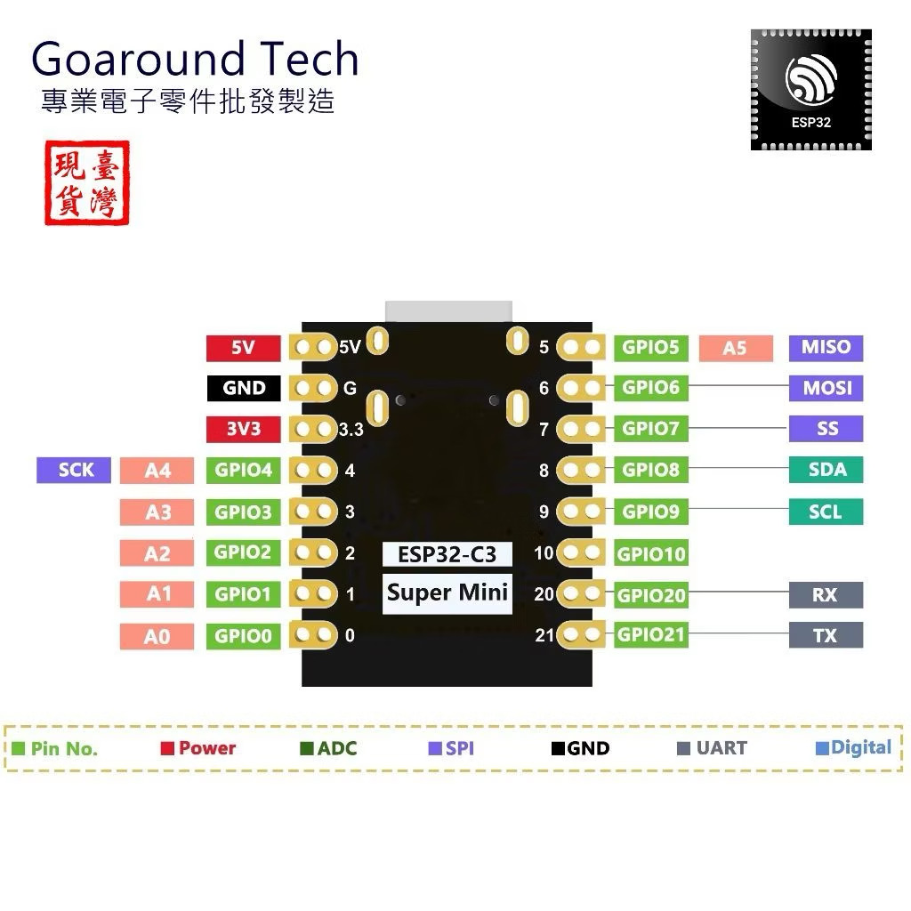
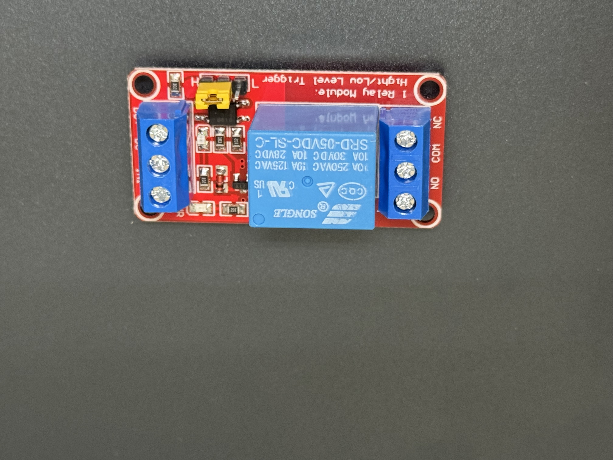
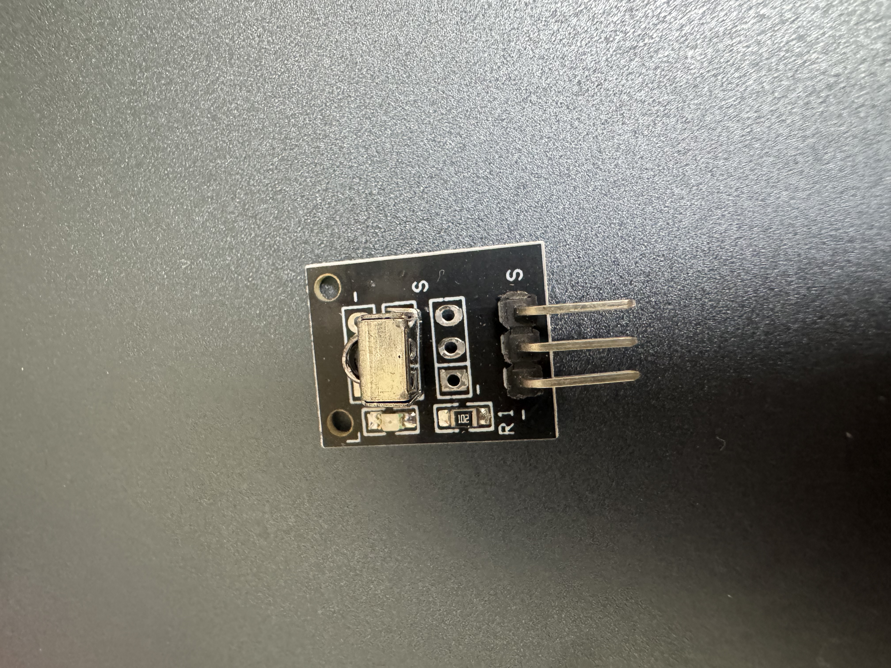
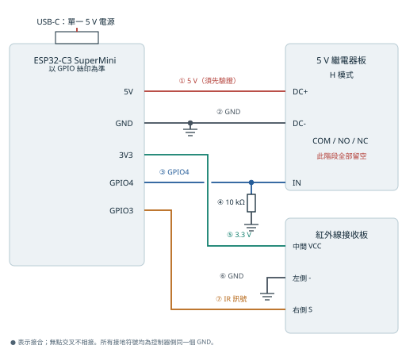
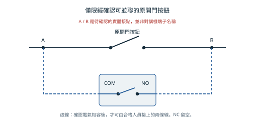

# ESP32-C3 門禁按鈕控制器｜接線與操作說明書

> Version 1.2 · 2026-11-13 · Software verified; hardware not connected.


## 01　ESP32-C3 門禁接線說明

適用：ESP32-C3 SuperMini、5 V H/L 繼電器板、1838／KY-022 類接收板。


> **現在可準備：控制器側的離線桌上測試**
> ESP32、繼電器與 IR 接收板組成獨立控制器。所有接線在斷電時進行；先不接對講機，繼電器 COM／NO／NC 全部留空。

這套裝置的作用是短暫「代按原有開門按鈕」。它不替換原鎖、不供電給原鎖，也不量測門是否關閉或鎖舌位置。Apple Home 顯示 OFF，不能當作已上鎖的證據。

工作方式

| 輸入 | 控制器動作 | 能確認的事情 |
| --- | --- | --- |
| Apple Home 的 ON 指令 | GPIO4 輸出約 400 ms，再自動 OFF | 程式下達釋放命令；不能確認門已打開 |
| Infrared remote | GPIO3 receives the learned button | 400 ms pulse; also works offline |
| Disconnect / reboot / fault | Disconnect stops HomeKit pulses; reboot/fault stops all | IR pulses are independent of Wi-Fi |


> **尚不可直接接：原對講機與電鎖線路**
> MG-C 與 MG-CE 不能直接視為同一電路。原按鈕的兩個接點、電壓／電流及是否可並聯均未確認。不要把 COM／NO 猜接到 EL、PT、AC、＋或－。

需要的材料

已選零件之外，準備合格穩壓 USB 5 V／至少 1 A 電源、USB-C 線、10 kΩ／0.25 W 電阻一顆、絕緣導線、適合的端子／焊接排針與絕緣外殼。照片中的板若尚未焊排針，需先完成可靠焊接；不可只把線塞入焊孔。

Read: 2 - parts; 3-4 - wiring; 5 - tests; 6 - firmware/HomeKit; 7 - intercom; 8 - troubleshooting; 9 - infrared; 10 - phone setup.


## 02　先認絲印，再認方向

以下照片取自本專案 img/；各張照片拍攝方向不同，不可直接照左右位置混接。





| 零件／觀察方向 | 本專案要用的標示 |
| --- | --- |
| ESP32：依上圖 USB-C 在上方 | 左列上至下：5V、GND、3V3、4、3、2、1、0。使用 GPIO4 與 GPIO3，其餘 GPIO 不接。 |
| 繼電器：如右上照片，接點排在左 | 左排上→下：NO、COM、NC；右排上→下：DC+、DC−、IN。黃色跳帽預定 H。旋轉後仍須重認絲印。 |
| IR：元件正面朝你、排針向下 | 左側「−」＝GND；中間＝電源；右側「S」＝訊號。照片中央未清楚印＋，仍需確認實板標示／腳位。 |


> **上電前的兩項必要確認**
> ① SuperMini 的 5V 焊點確實是 USB VBUS，且路徑能供應繼電器。② 接 IN 前，先由適任人員確認輸入端不會把 5 V 回灌 GPIO，且 H 模式能可靠接受 3.3 V HIGH。照片無法證明這兩項，未確認就不要聯動測試。


## 03　控制器側接線圖

功能接線示意，不代表板子的實體端子排列。編號對應下一頁逐線表。




> **10 kΩ 是下拉電阻，兩端分別接 GPIO4 與 GND**
> GPIO4 → IN 的訊號線直接相接；電阻由該訊號線分岔接往 GND，不是串聯在 IN 線上。下拉只能協助避免浮接，仍須實測開機毛刺。

紅：5 V 電源｜綠：3.3 V 電源｜藍：繼電器控制｜橘：IR 訊號｜灰：控制器 GND。顏色僅供辨識，實作時先核對端子名稱。

USB-C 只接一個電源。若 5V 焊點無法供應繼電器，應先重新確認同一個穩壓 5 V 電源的分配方式；不可一邊接 USB 供電，一邊再往 5V 焊點接另一顆電源。


## 04　逐線接好，再上電

先拔除 USB 與所有電源，繼電器 COM／NO／NC 保持空接。

| 編號 | 從哪裡 | 接到哪裡 | 注意事項 |
| --- | --- | --- | --- |
| ① | ESP32 5V | 繼電器 DC+ | 先驗證 USB VBUS 與供電能力；供線圈，不是 GPIO 供電。 |
| ② | ESP32 GND | 繼電器 DC− | 只共用控制器側接地。 |
| ③ | ESP32 GPIO4 | 繼電器 IN | H 模式，預定 3.3 V HIGH 觸發。 |
| ④ | GPIO4／IN 節點 | 10 kΩ → GND | 電阻無方向；並接下拉，不是串接。 |
| ⑤ | ESP32 3V3 | IR 中間電源腳 | 本專案使用 3.3 V，避免 S 輸出 5 V 邏輯。 |
| ⑥ | ESP32 GND | IR 左側 − | 與②、④為同一個控制器 GND。 |
| ⑦ | ESP32 GPIO3 | IR 右側 S | 接收訊號，不供電。 |
| USB | 單一合格 5 V 電源 | ESP32 USB-C | 至少 1 A；初期燒錄改用電腦 USB，不再額外接其他電源。 |

組裝順序

1. 斷電，把繼電器黃色 H/L 跳帽確認設為 H；不確定跳帽跨哪兩針時，先看實板 H／L 絲印，不要通電試猜。
2. 依②⑥④先接 GND 與下拉電阻，再接③⑦訊號線。
3. 確認⑤的 3.3 V 電源，以及①條件成立後的 5 V 電源線。
4. 檢查端子夾緊、線芯不外露、無相鄰短路；低壓區接線固定後，才接 USB。


> **不要用 GPIO 驅動繼電器線圈**
> GPIO4 只接模組 IN；線圈電源由模組 DC+／DC− 取得。不要把繼電器 DC+ 接到 3V3，也不要把任何 5 V、12 V 或 24 V 訊號送入 GPIO。


## 05　桌上測試：接點仍不接對講機

目前完成的是虛擬測試。以下為將來有硬體時的驗證步驟，尚未執行。

| 順序 | 測試方法 | 通過條件 |
| --- | --- | --- |
| 1｜不通電檢查 | 檢查供電極性、H 跳帽、電阻接法、COM／NO／NC 留空。先完成第 2 頁兩項電氣確認。 | 沒有錯接或鬆動；未確認 3.3 V 觸發能力時先停止。 |
| 2｜只上控制器電源 | 由適任人員用電表 DC 電壓檔量 5V、3V3 對控制器 GND。避免表筆碰短相鄰腳。 | 供電正常；GPIO4 靜止 LOW，繼電器保持釋放。 |
| 3｜檢查未帶電的乾接點 | 確認接點完全沒有外接電源或對講機線，再以導通檔量 COM–NO／COM–NC。 | 未動作：COM–NO 不導通，COM–NC 導通。 |
| 4｜短脈衝 | 先完成下一頁設定，從 Apple Home 發出 ON。用合適的量測工具確認 GPIO4 波形／接點動作。 | 單次約 400 ms 後釋放；不能只憑聽到「喀」判定通過。 |
| 5 | Fault tests | Test repeated presses, Wi-Fi/HomeKit loss, reboot and power cycling. | No extended pulse; network loss stops HomeKit only; no replay after reboot. |
| 6 | IR setup | Use Learn button on the setup website; press the same button twice with a 500 ms release. See pages 9-10. | Learning never releases; a later press gives one 400 ms pulse. |

一般電表的更新速度可能漏掉 400 ms 脈衝；量測脈寬可使用適合 3.3 V 邏輯的示波器或邏輯分析儀。電表導通檔只能用在已確認未帶電、隔離的接點，不可拿去量正在通電的原對講機線路。


> **出現誤吸合或 3.3 V 無法可靠觸發，就停止**
> 先拔除控制器電源，不接對講機。檢查跳帽與實際輸入電路，改用已確認相容的驅動器或明確支援 3.3 V 的繼電器板；不可把 5 V 回灌 GPIO。


## 06　韌體設定與 Apple Home

現在仍可只執行模擬；實機設定及配對列於此，方便之後照順序操作。

A. 不需要硬體的虛擬測試

```text
python tools/simulate.py test
python tools/simulate.py demo
python tools/simulate.py interactive
```

Controller, IR learning/storage and timer tests include 20,000 random events. session on is a simulation input, not real HomeKit authentication.

B. 有硬體時才進行：私密設定與燒錄

1. No secrets.h is required. Wi-Fi, the access password and IR can be configured from your phone after upload (page 10). A pairing code is generated and saved automatically.
2. Optional secrets.h seeds factory defaults only; saved web settings take precedence.
3. Open DoorRelease.ino in Arduino IDE. Use Arduino-ESP32 3.3.0, HomeSpan 2.1.8, IRremote 4.4.1; ESP32C3 Dev Module, 4 MB flash, Huge APP (3 MB), USB CDC On Boot enabled.
4. Select the actual USB port and upload. Use BOOT/RST if required. Keep all relay contacts disconnected.

專案的 tools/setup.ps1 安裝工具；tools/build-firmware.ps1 只編譯，不會上傳。build/configured-check/ 內的資料是虛構編譯測試值，不可拿來當部署設定。

C. Apple Home 與 HomePod

1. ESP32 與 HomePod／Apple TV 家庭中樞需可在家中區域網路互通，避免用戶端隔離的訪客網路。
2. 在「家庭」App 新增配件，依 App 的其他選項／手動加入流程，找 Front Door Release 並輸入自己的配對碼。此專案不提供預設配對 QR code。
3. 在接點空接狀態測試 ON → 約 400 ms → OFF。啟動保護為 3 秒，停止後冷卻至少 2 秒。
4. 要測試外出控制，先確認家庭中樞正常，再關閉手機 Wi-Fi，使用行動網路測試。不要設定路由器連接埠轉送。

Use the setup website for Wi-Fi and IR. Optional USB IR commands remain available. Pairing does not verify electrical compatibility.


## 07　接入原按鈕：須先確認 A／B

本頁是條件式接法，不是 MG-C／MG-CE 端子對照表；現階段尚不可照圖接入原系統。



安裝人員須先確認

1. 實際室內機與電鎖型號，以及原開門按鈕的兩個實體接點 A／B。
2. 按鈕是否為可外加並聯接點的瞬時開關；A／B 的閒置與操作電壓（AC／DC）、電流、所需脈衝時間。
3. 整塊繼電器模組、端子及配線的額定是否適用，及是否會影響其他室內機。不能只看藍色繼電器外殼的最大額定值。
4. 確認電氣相容、隔離與接線方式後，才將 COM／NO 分別接至 A／B；NC 不接。機械接點一般無極性，但實際電路相容性仍需確認。


> **控制器與對講機：只可能透過驗證後的機械接點介接**
> ESP32 的 GND、5V、3V3 不接對講機／MG-P 的 −、＋、AC、EL、PT。既有 PT／門開指示燈不改動。不得試短路 EL、PT、AC 等端子來找開門線。

接入後需重新驗證原按鈕、門鈴、通話、機械開門與其他室內機仍正常；再確認斷線／斷電不會誤釋放。若原按鈕不是可並聯的簡單接點，或量測不符合模組能力，應重新設計介面。


## 08　排錯、驗收與留存紀錄

接線完成不等於可投入實際門禁使用；需保留原本的手動／機械開門方式。

| 現象 | 處理 |
| --- | --- |
| Relay does not move | Check boot guard, cooldown, power and trigger compatibility. For HomeKit check credentials/pairing; for IR use ir status. |
| 繼電器動作時 ESP32 重啟 | 檢查供電能力、USB 線、接線與干擾。不要靠延長脈衝處理。 |
| IR received; no release | Use ir status. Check enrollment, supported protocol, 500 ms release, boot guard and cooldown. See page 9. |
| 家庭 App 顯示 OFF | 只代表釋放動作已結束，不表示門已關閉或上鎖。 |
| 開機誤吸合／原按鈕異常 | 立即停止；由適任人員隔離外加控制器並恢復原電路，重新檢查。 |

驗收表（由實測人員填寫）

| 項目 | 紀錄 |
| --- | --- |
| 板子版本／繼電器型號 | ________________________________________ |
| USB 5V 路徑／3.3V 觸發驗證 | ________________________________________ |
| 室內機／電鎖型號、A／B 位置 | ________________________________________ |
| A／B 電壓 AC/DC、電流與接點適用性 | ________________________________________ |
| 實測脈衝、上電／斷線結果 | ________________________________________ |
| 驗證日期／安裝人員 | ________________________________________ |

資料依據與限制

原始依據：door_lock_instructions.md、img/ 實拍與商品腳位圖；軟體依據：firmware/DoorRelease/、README.md、VALIDATION.md。實物版本、繼電器輸入電路及原開門按鈕尚未實測確認。

- [Espressif：ESP32-C3 Datasheet](https://documentation.espressif.com/esp32-c3_datasheet_en.html)
- [Joy-IT：KY-022 參考規格（3.3–5 V／38 kHz；不證明此實板腳位）](https://sensorkit.joy-it.net/en/sensors/ky-022)
- [Apache NuttX：SuperMini 板型差異與腳位參考](https://nuttx.incubator.apache.org/docs/latest/platforms/risc-v/esp32c3/boards/esp32c3-supermini/index.html)

## 09　Infrared learning and release

Phone setup on page 10; HomeKit and infrared can operate together.

Learn one unlock button

1. Open the setup website from your phone on local Wi-Fi or the setup AP (page 10). Keep relay contacts disconnected during setup.
2. Select Learn button. Release all remote buttons for at least 500 ms, then press the intended button once.
3. After the first-press message, release for at least 500 ms and press the same button again within 30 seconds.
4. Button learned and saved confirms storage. Learning never opens the door. Release and press again to request a 400 ms pulse.

Optional USB commands (115200 baud)

```text
ir help
ir status
ir learn
ir cancel
ir forget
```

The website also offers Cancel learning and Forget button. A failed erase may leave a persistent key; retry until successful. Closing the setup window cancels unfinished learning and retains the previous button.

Shared control and limits

HomeKit and IR share a 3 s boot guard, 400 ms pulse and 2 s cooldown. Requests during a pulse return busy; during cooldown they return cooldown. Requests never queue or extend a pulse. Authenticated HomeKit OFF stops either source. Wi-Fi loss stops only HomeKit pulses; learned IR works offline. Learning inhibits both sources.

Supported: NEC/NEC2, Sony, Samsung/SamsungLG, RC5, RC6 and JVC. Held buttons, repeats, parity errors, overflow and unsupported decoders are rejected. A new press requires 500 ms without decoded activity. The key persists in NVS; an unfinished learning session does not.


> **Placement and verification**
> IR codes are copyable and replayable. Place the receiver in a protected interior location. Software tests and compilation do not replace hardware or Apple Home verification. Full instructions: docs/infrared_setup.md.


## 10　Wi-Fi and setup access

After the first firmware upload, routine setup needs only your phone.

First connection

1. With no saved Wi-Fi, join DoorRelease-XXXXXX on your phone. Initial AP password: DoorSetup-2026.
2. Open http://192.168.4.1/ in a regular browser. Username: admin. Initial login password: DoorSetup-2026. Private factory overrides take precedence.
3. Enter the 2.4 GHz Wi-Fi name and password. Optionally change New setup password; it becomes both the AP and web login password.
4. Select Save and restart. After reconnecting your phone to home Wi-Fi, open http://door-release-xxxxxx.local/ (the AP suffix in lowercase), or use the device IP from your router.
5. The page provides IR learning and shows the HomeKit pairing code. Wi-Fi changes retain paired controllers and the IR button.

When setup stays available

| Connection state | Setup behavior |
| --- | --- |
| No saved network | AP and website start immediately. |
| Saved network unavailable | After 30 s start AP; retry the network every 30 s. |
| Online before 10 minutes | AP is off; website is available on the LAN. |
| Online after 10 minutes | Website is off; HomeKit and learned IR still work. |
| Offline beyond 10 minutes | Keep AP and website available until Wi-Fi connects. |
| Later connection loss | Reopen AP after 30 s, even beyond the normal deadline. |

A connection means Wi-Fi with an IP address; internet access is not required. If Wi-Fi connects after the deadline, AP and website close immediately. Restart to reopen the normal setup window. Restart does not reset your saved password.

Save and recovery

Wi-Fi and access settings are validated, committed to NVS and verified before restart. No current password is returned by the page. Leave Wi-Fi password empty only to retain it for the unchanged SSID; explicitly select the checkbox for an open network. A blank setup password retains the existing one.

Setup uses TCP 80; HomeKit uses TCP 1201 advertised through Bonjour. No port is entered in the Home app. Real AP, mDNS and iPhone/HomePod behavior still need hardware verification. Detailed instructions: docs/web_setup.md.
